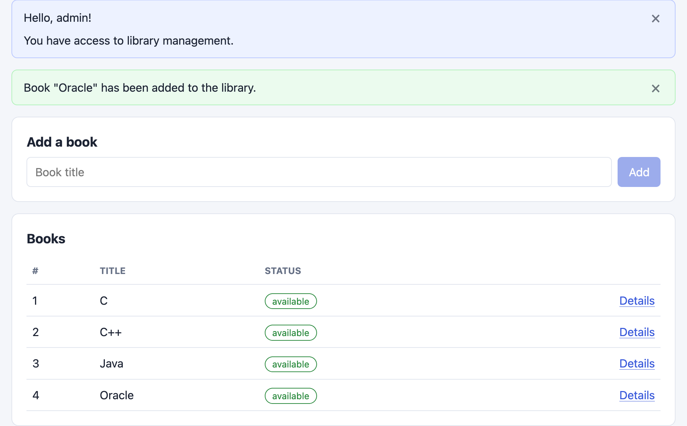
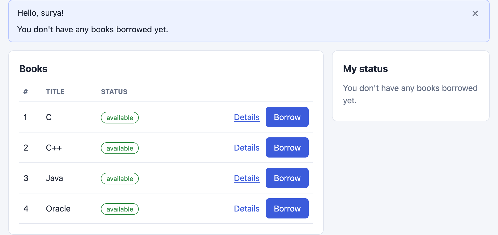
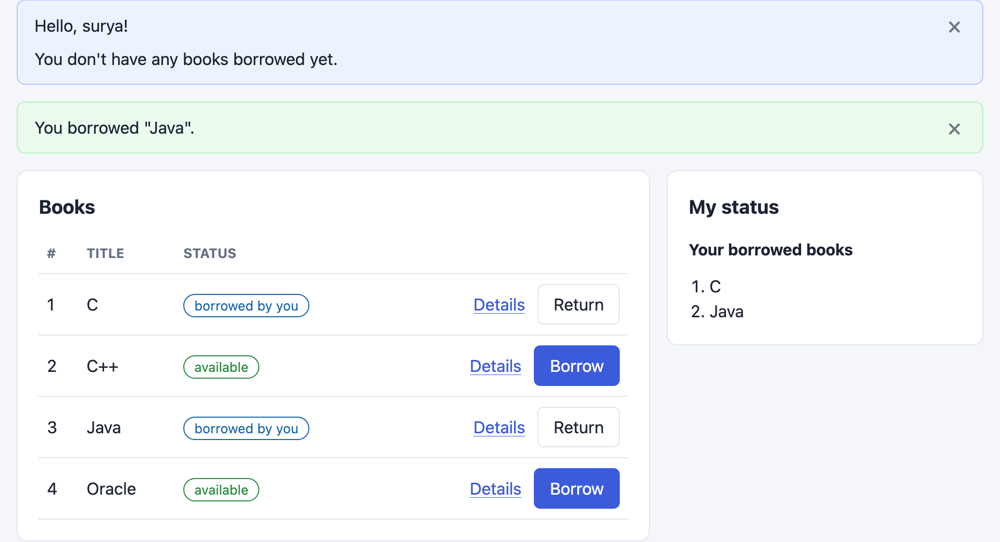
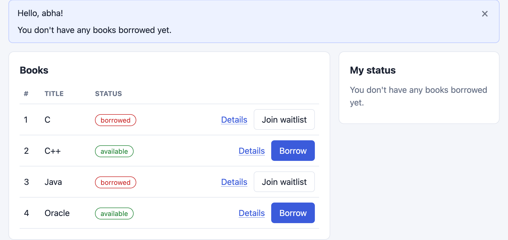
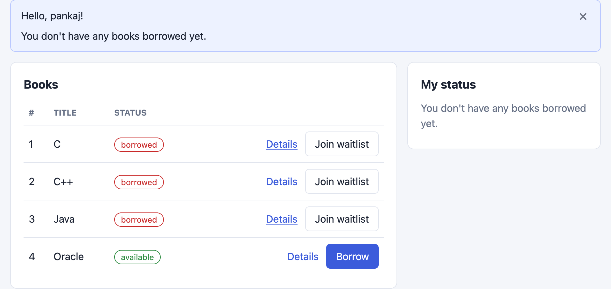
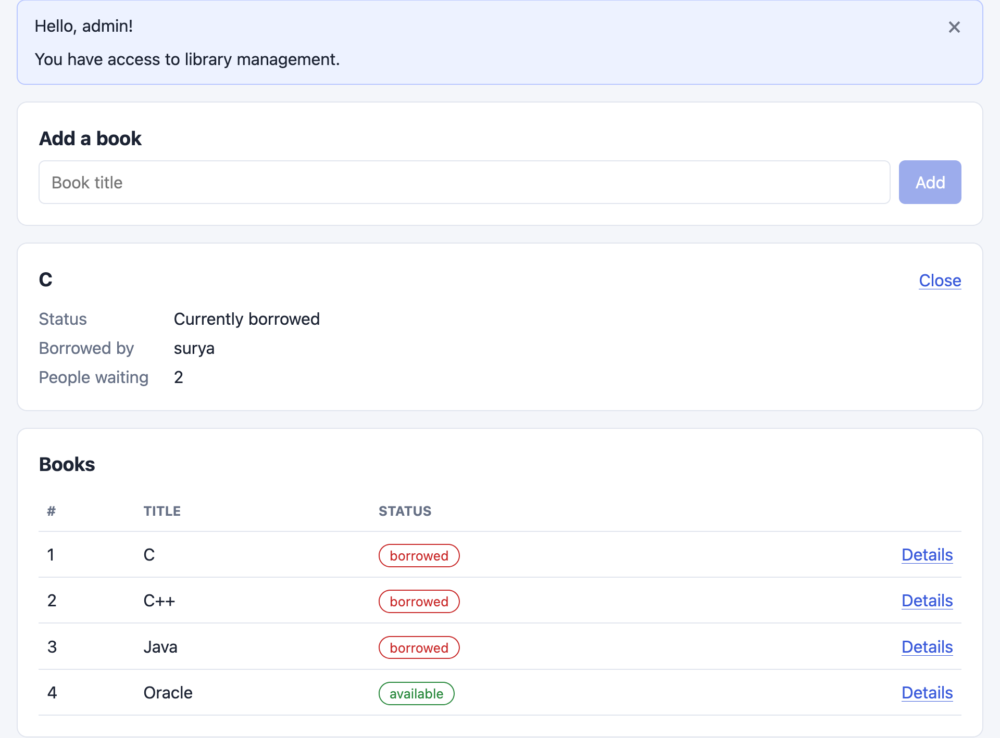
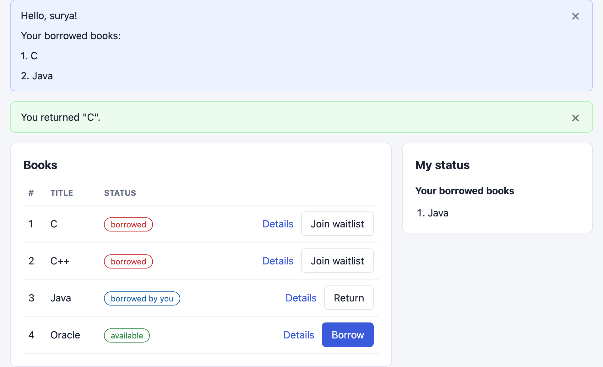
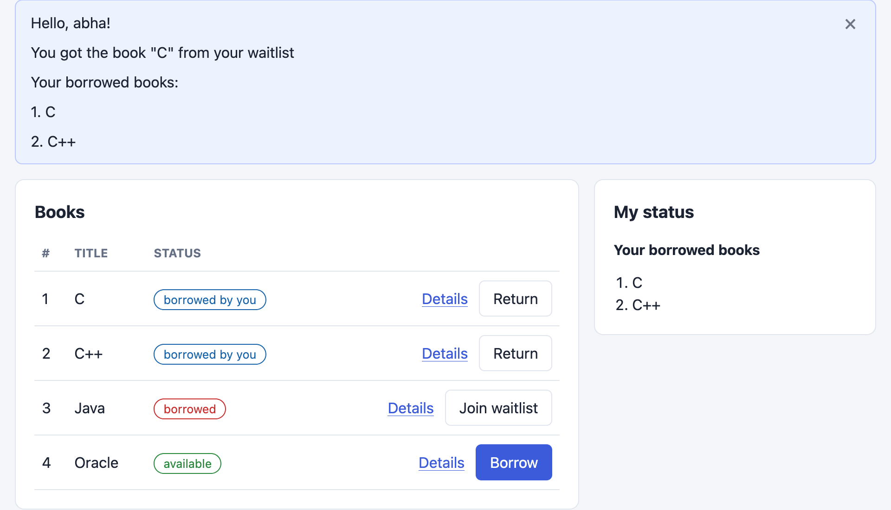

# Library Management

Angular frontend + Spring Boot REST API with an in-memory data store. All state exists only while the app is running, so each restart starts with a clean database.

## Prerequisites

- Java 21+
- Node.js and npm
- A terminal with bash access

## Run the app

```bash
./start.sh
```

Then open http://localhost:9999 in your browser.

To run the app on a different port:

```bash
PORT=8080 ./start.sh
```

`start.sh` installs frontend dependencies, builds the Angular app, copies the production files into the Spring Boot static resources, packages the backend with the Maven wrapper, and starts the application.

## Tests

```bash
cd backend && ./mvnw test
cd frontend && npm test -- --watch=false
```

## Features

- Admin-only book management
- User login by username (no password required)
- Borrow and return books
- Join and manage a waitlist
- View personal status, including borrowed items and waitlist activity

## Usage

Log in with any name. New users are created automatically on first login. Log in as `admin` to add books. Other users can borrow, return, join a waitlists, and view their status.

| Command | In the UI | Endpoint |
|---------|-----------|----------|
| `login` | Login page | `POST /api/auth/login` |
| `add` | "Add a book" form (admin only) | `POST /api/books` |
| `list` | Books table | `GET /api/books` |
| `borrow` | Borrow button | `POST /api/borrow` |
| `return` | Return button | `POST /api/return` |
| `waitlist` | Join waitlist button | `POST /api/waitlist` |
| `book status` | Details link on a book | `GET /api/books/detail` |
| `status` | "My status" panel | `GET /api/status` |
| `logout` | Logout button | `POST /api/auth/logout` |

## Project layout

```text
backend/   Spring Boot application (controller -> service -> in-memory repository)
frontend/  Angular application
start.sh   Build + run script
```

## Decisions and assumptions

- Login is by username only; no password is required. A random token is generated per login and sent in the `X-Auth-Token` header.
- Usernames and book titles are matched case-insensitively while ignoring surrounding spaces. The first spelling is kept for display.
- When a book is returned and people are waiting, it is assigned to the first person in line immediately. They see "You got the book ... from your waitlist" the next time they log in.
- Adding a book that already exists, borrowing a book you already hold, or waitlisting a book that is already available, borrowed by you, or already waitlisted by you is rejected with a message.
- After login, members see the summary of borrowed books, waitlists, and waitlist notifications. Book details show the waitlist size and a user's position; only `admin` also sees who is currently holding the book.
- `admin` manages books only and cannot borrow, return, or waitlist.

## Demo flow

- Login as `admin` and add some books



- Log out and log in as another user, for example `surya`, and borrow books




- Log out and log in as another user, such as `abha`, and join the waitlist



- Log out and log in as another user, such as `pankaj`, join the waitlist, and click Details to view the book details



- Log out and log in as `admin` to review the details



- Log out and log in as `surya` and return a book



- Log in as `abha` to see the message that the book has been automatically allocated

